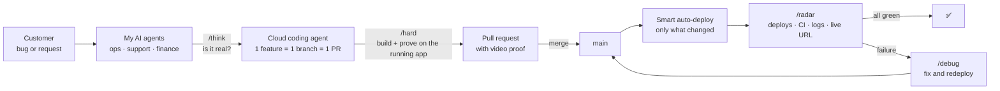

# Hi, I'm Roméo 👋

**AI Product Engineer** · I design and ship tech products end to end, with my own system of AI agents.

I've been building things since I was 8. I moved from e-commerce into software and AI, and I now design, build and sell products on my own, from the first idea to production.

🎯 **Goal:** build a great tech product as the first engineer of an AI startup in Paris.

---

## How I work

I run my company like a CEO with a team, except the team is AI agents. For every role I would hire a human for, I set up an agent with its own tools and routines: operations, finance, customer success, and more. They work day and night.

When a customer reports a bug, I don't need my laptop. An agent picks it up, checks whether the bug is real, and launches a cloud coding agent to fix it. That agent proves the fix works on the running app with a video, then I merge from my phone. After every merge, another agent checks that production is healthy.

### The rules every agent follows

Every skill carries the same engineering mindset:

- **The smallest, simplest change** that solves the problem.
- **Question everything.** Should this exist at all? What can we delete?
- **Fight complexity** like entropy. A simple codebase is easy to understand, maintain and grow.
- **Prove it works.** No "it should work": the agent tests on the real running app and shows a video.

### [Workflow](https://github.com/romeohc/Workflow): the system, open source

I packaged this way of working into a plugin anyone can install on any app and any stack, for Cursor, Claude Code and Codex.

| Skill | What it does |
|---|---|
| `/setup` | One command installs the workflow on your app: smart auto-deploy and a production checker built for your stack |
| `/think` | Read-only. The agent thinks like an engineer and a founder before anything gets built |
| `/hard` | Build, then prove it on the running app with screenshots and a video |
| `/fast` | Build quickly without proof, for small or UI changes |
| `/debug` | Reproduce, prove the root cause, apply the smallest fix |
| `/radar` | After every merge: deploys, CI, logs and live URL checked, answers ✅ when all is green |

**Building now:** an agent that reviews every pull request for quality and security, checks the video proof matches the request, and merges on its own. That removes the last human bottleneck: me.

---

## What I've built

| Project | What it is | Proof |
|---|---|---|
| **[Novex](https://novex.trading)** | A macroeconomic and fundamental data SaaS for investors, designed, built and sold on my own. Built and run with this workflow. | **€2,100 MRR** · 2,000+ accounts created |
| **FantomPad** | A hardware and software product for traders: a physical device, a SaaS and an expert advisor (EA). | Manufactured in China with my own suppliers |
| **TradeX** | A trading journal with AI that analyzed each user's performance. My first real app. | ~100 users |
| **Jarvis** | A fully voice-driven autonomous AI agent with long-term memory. | Built almost 2 years before personal AI agents went mainstream |
| **Ohbijoux** | An e-commerce jewelry brand I launched at 17. | €40–50k revenue from organic content alone |

## Stack

- **Product:** TypeScript · Next.js · React · Tailwind CSS
- **Backend & data:** Convex · Node.js · Hono · Better Auth · Stripe
- **AI:** MCP (Model Context Protocol) · Cursor · Claude Code · Codex · Grok Bot
- **Infra & quality:** Vercel · Fly.io · GitHub Actions · Vitest

---

## Links

[LinkedIn](https://www.linkedin.com/in/romeo-hc/) · [X](https://x.com/romeohc_) · [novex.trading](https://novex.trading)
