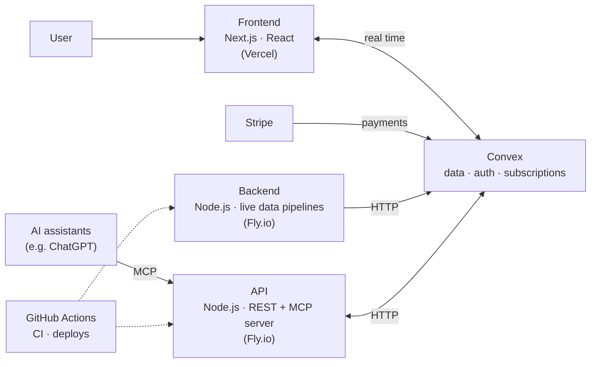

# Hi, I'm Roméo 👋

**AI Product Engineer** · I design and ship tech products end to end, with my own system of AI agents.

I've been building things since I was 8. I moved from e-commerce into software and AI, and I now design, build and sell products on my own, from the first idea to production.

🎯 **Goal:** build a great tech product as the first engineer of an AI startup in Paris.

---

## What I've built

| Project | What it is | Proof |
|---|---|---|
| **[Novex](https://novex.trading)** | A macroeconomic and fundamental data SaaS for investors, designed, built and sold on my own. | **€2,100 MRR** · 2,000+ accounts created |
| **FantomPad** | A hardware and software product for traders: a physical device, a SaaS and an expert advisor (EA). | Manufactured in China with my own suppliers |
| **TradeX** | A trading journal with AI that analyzed each user's performance. My first real app. | ~100 users |
| **Jarvis** | A fully voice-driven autonomous AI agent with long-term memory. | Built almost 2 years before personal AI agents went mainstream |
| **Ohbijoux** | An e-commerce jewelry brand I launched at 17. | €40–50k revenue from organic content alone |

> Novex's code is private. Here is how it fits together.

### Novex architecture

---

## How I ship

I work with a team of AI agents that I set up and direct. Every change goes through a pull request, CI, and an automatic deploy on merge, then an agent checks that production matches `main`.

- **169 merged pull requests** on Novex since late August 2026
- My workflow is public: **[romeohc/Workflow](https://github.com/romeohc/Workflow)**, the skills my agents follow on every app

## Stack

**Product:** TypeScript · Next.js · React · Tailwind CSS
**Backend & data:** Convex · Node.js · Hono · Better Auth · Stripe
**AI:** MCP (Model Context Protocol) · Cursor · Claude Code · Codex
**Infra & quality:** Vercel · Fly.io · GitHub Actions · Vitest

---

## Links

[LinkedIn](https://www.linkedin.com/in/romeo-hc/) · [novex.trading](https://novex.trading)
