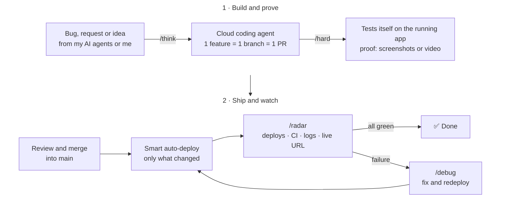

# Roméo HC

**AI Product Engineer.** I design and ship complete products on my own. I run my work like a startup with a full team, except the team is AI agents: every role a company needs has its own agent, working day and night. I stay the decision-maker.

🎯 Looking to be the first engineer of an AI startup in Paris.

## ⭐ [afkit](https://github.com/romeohc/afkit): my way of working, open source

This is how I ship code. Cloud coding agents build it, test it themselves on the running app in real conditions, prove it works, then check production after the deploy. I'm turning it into **afkit**, a free plugin anyone can install on any app.

Every skill follows the same rules: **keep it simple, question everything, delete what's useless, prove it works.**

👉 **[See how it works](https://github.com/romeohc/afkit)**

## What I've built

| Project | What it is | Proof |
|---|---|---|
| **[Novex](https://novex.trading)** | A macroeconomic and fundamental data SaaS for investors, designed, built and sold on my own. | **€2,100 MRR** · 2,000+ accounts created |
| **FantomPad** | A hardware and software product for traders: a physical device, a SaaS and an expert advisor (EA). | Manufactured in China with my own suppliers |
| **Jarvis** | A fully voice-driven autonomous AI agent with long-term memory. | Built almost 2 years before personal AI agents went mainstream |
| **Ohbijoux** | An e-commerce jewelry brand I launched at 17. | €40–50k revenue from organic content alone |

## Stack

- **Product:** TypeScript · Next.js · React · Tailwind CSS
- **Backend & data:** Convex · Node.js · Better Auth · Stripe
- **AI:** Cursor (cloud agents) · Grok Bot
- **Infra & quality:** Vercel · Fly.io · GitHub Actions · Vitest

[LinkedIn](https://www.linkedin.com/in/romeo-hc/) · [X](https://x.com/romeohc_)
