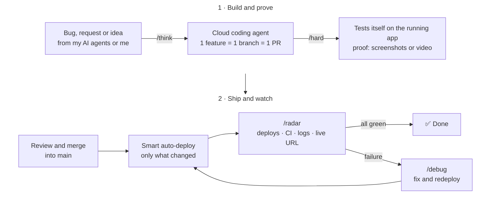

# Hi, I'm Roméo 👋

**AI Product Engineer** · I design and ship complete products on my own, with a team of AI agents.

🎯 **Goal:** build a great tech product as the first engineer of an AI startup in Paris.

---

## How I work

I run my work like a startup with a full team, except the team is AI agents. Every role a company needs has its own agent, working on its own, day and night.

For development, coding agents in the cloud build each change, then test it themselves on the running app, in real conditions, and prove it works before anything ships. I stay the decision-maker.

Every agent follows the same rules: **keep it simple, question everything, delete what's useless, prove it works.**

## [Workflow](https://github.com/romeohc/Workflow): my way of working, free and open source

I'm turning this system into a plugin that anyone can install on any app, in one command. Same agents, same rules, same proof, for free.

---

## What I've built

| Project | What it is | Proof |
|---|---|---|
| **[Novex](https://novex.trading)** | A macroeconomic and fundamental data SaaS for investors, designed, built and sold on my own. | **€2,100 MRR** · 2,000+ accounts created |
| **FantomPad** | A hardware and software product for traders: a physical device, a SaaS and an expert advisor (EA). | Manufactured in China with my own suppliers |
| **TradeX** | A trading journal with AI that analyzed each user's performance. My first real app. | ~100 users |
| **Jarvis** | A fully voice-driven autonomous AI agent with long-term memory. | Built almost 2 years before personal AI agents went mainstream |
| **Ohbijoux** | An e-commerce jewelry brand I launched at 17. | €40–50k revenue from organic content alone |

## Stack

- **Product:** TypeScript · Next.js · React · Tailwind CSS
- **Backend & data:** Convex · Node.js · Better Auth · Stripe
- **AI:** Cursor (cloud agents) · Grok Bot
- **Infra & quality:** Vercel · Fly.io · GitHub Actions · Vitest

---

[LinkedIn](https://www.linkedin.com/in/romeo-hc/) · [X](https://x.com/romeohc_)
